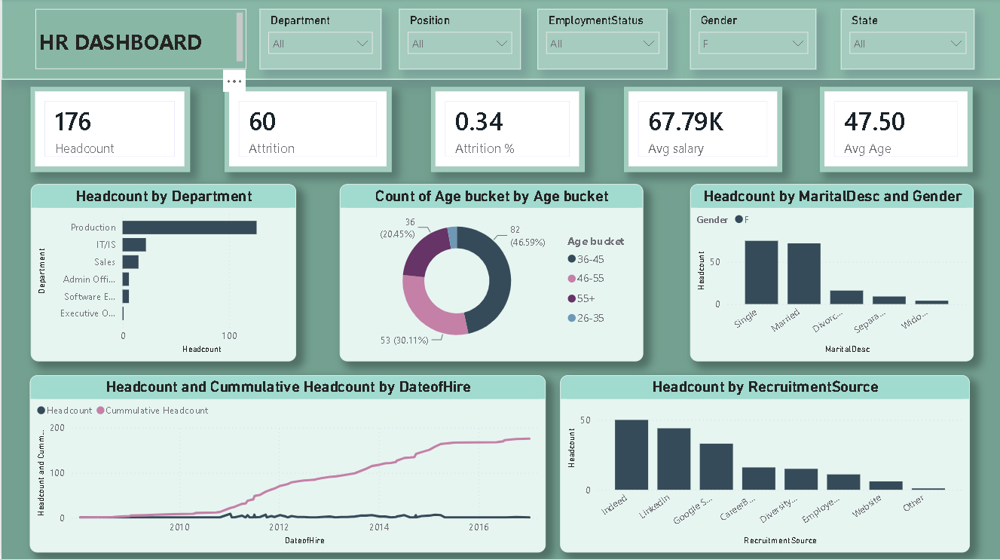

# 📊 HR Analytics Dashboard

An interactive HR Analytics Dashboard built using **Microsoft Power BI** to analyze employee data and understand workforce trends. The dashboard provides insights into employee demographics, attrition, salary distribution, departmental analysis, and recruitment patterns.

The project demonstrates data analysis and visualization skills, including KPI development, interactive dashboard design, and transforming raw employee data into meaningful business insights.

## ✨ Features

📊 **HR Overview —** View key workforce metrics, including total headcount, employee attrition, attrition rate, average salary, and average age.

🏢 **Department Analysis —** Analyze employee distribution across different departments.

👥 **Employee Demographics —** Explore employee data based on age groups, gender, and marital status.

📈 **Hiring Trends —** Understand employee hiring patterns and cumulative headcount over time.

🎯 **Recruitment Analysis —** Analyze recruitment sources to understand how employees were hired.

🔍 **Interactive Filters —** Filter dashboard insights using Department, Position, Employment Status, Gender, and State.

📉 **Attrition Analysis —** Examine employee attrition and workforce patterns through visual reports.

## 🛠️ Tech Stack

**Data Source**
- Microsoft Excel

**Data Visualization & Analysis**
- Microsoft Power BI
- DAX (Data Analysis Expressions)

**Tools**
- Power BI Desktop
- Microsoft Excel
- Git
- GitHub

## 🏗️ Dashboard Architecture

The dashboard follows a simple data analysis workflow:

                    ┌─────────────────┐
                    │  Excel Dataset  │
                    │ Employee Records│
                    └────────┬────────┘
                             │
                             ▼
                    ┌─────────────────┐
                    │   Power BI      │
                    │ Data Analysis   │
                    └────────┬────────┘
                             │
                             ▼
                    ┌─────────────────┐
                    │  DAX Measures   │
                    │ KPI Calculations│
                    └────────┬────────┘
                             │
                             ▼
                    ┌─────────────────┐
                    │ Interactive     │
                    │ HR Dashboard    │
                    └─────────────────┘

## 📂 Project Structure

HR-Analytics-Dashboard/
│
├── HR_DASHBOARD.pbix
├── HRDataset_v14.xlsx
├── screenshots/
│   └── dashboard-overview.png
│
└── README.md


### 📸 Dashboard Preview

HR Analytics Dashboard


## 🔄 Data Analysis Flow

**Data Source —** Employee records are provided through an Excel dataset containing 311 employee records.

**Data Analysis —** The dataset is used in Power BI to explore employee information and workforce trends.

**KPI Development —** Key metrics such as headcount, attrition, attrition rate, average salary, and average age are presented.

**Data Visualization —** Different charts and visual elements represent departmental distribution, demographics, hiring trends, and recruitment sources.

**Interactive Exploration —** Users can apply slicers to filter the dashboard and explore specific employee groups.

## 📊 Key Performance Indicators

The dashboard includes the following KPIs:

- **Total Headcount:** Total number of employees.
- **Employee Attrition:** Number of employees who left the organization.
- **Attrition Rate:** Percentage of employees who left.
- **Average Salary:** Average salary of employees.
- **Average Age:** Average age of employees.

## 🚀 Getting Started

### Prerequisites

Make sure the following software is installed:

- Microsoft Power BI Desktop
- Microsoft Excel

### 1. Clone the Repository

```bash
git clone https://github.com/02Tirtha/HR-Analytics-Dashboard.git

cd HR-Analytics-Dashboard
```

### 2. Open the Dashboard

1. Locate the `HR_DASHBOARD.pbix` file.
2. Open it using Microsoft Power BI Desktop.
3. Explore the dashboard and interact with the available filters and slicers.

### 3. Explore the Dataset

The `HRDataset_v14.xlsx` file contains the employee records used for the dashboard analysis.

## ☁️ Deployment & Usage

This project is developed using Power BI Desktop.

The `.pbix` file can be downloaded from this repository and opened locally using Power BI Desktop to explore the dashboard and its interactive visualizations.

## 🧪 Dashboard Analysis

The dashboard provides insights into:

- Overall employee headcount and attrition.
- Department-wise workforce distribution.
- Employee demographics.
- Hiring trends and cumulative headcount.
- Recruitment source distribution.
- Workforce patterns using interactive filters.

## 📌 Future Improvements

- Add more detailed employee attrition analysis.
- Include additional HR performance indicators.
- Improve dashboard interactivity and visual storytelling.
- Explore advanced data transformation and reporting capabilities.

## 👨‍💻 Author

**Tirtha Jhaveri**

GitHub: https://github.com/02Tirtha

## 📄 License

This project is available for educational and development purposes.
